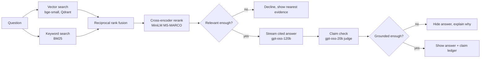

# ATLAS — answers that show their evidence

[](https://github.com/saccromcyes/ATLAS-Trust-Layered-GenAI-System/actions/workflows/ci.yml)
[](https://saccromcyes-atlas.onrender.com)
[](LICENSE)

ATLAS is a retrieval-augmented generation (RAG) system built around one question: **can you trust the answer?**

- Every sentence cites the passage it came from, and you can click through to read it.
- After answering, a second model splits the answer into individual claims and checks each one against the evidence. Answers that don't check out are hidden.
- When the documents don't contain the answer, ATLAS says so instead of guessing, and shows you how close the nearest passage came.

**[Try the live demo →](https://saccromcyes-atlas.onrender.com)** Ask about the bundled handbook and policies of a fictional drone company, or upload your own PDF. It runs on a free tier, so if nobody has used it for a while the first visit takes about a minute to wake up.

<!-- Screenshot added after the first deploy: docs/screenshot.png -->

## How it works



1. **Hybrid retrieval.** Embedding search catches paraphrases ("non-birthing parent" → "secondary caregiver"); BM25 catches exact terms like "SEV1" or "$0.67". Their rankings are merged with reciprocal rank fusion, which needs no score calibration between the two.
2. **Reranking.** A cross-encoder reads the question and each candidate passage *together*, which is far more precise than comparing two separately computed vectors. Together with the embedding similarity, its score drives the first refusal gate: ATLAS refuses before calling the model only when both say nothing relevant was found. (The cross-encoder alone scored reworded questions near zero and refused questions it could answer; the evaluation below shows the trade-off for each setting.)
3. **Cited generation.** The answer streams token by token. The prompt requires a citation on every factual sentence, forbids outside knowledge, and treats document text as untrusted data (a basic prompt-injection defence).
4. **Claim verification.** A smaller, faster model extracts atomic claims and labels each one supported, partly supported or unsupported. The groundedness score is the share that checks out; below the threshold, the answer is withheld.
5. **Graceful degradation.** If the LLM provider is down, rate-limited or not configured, ATLAS still answers by quoting the best evidence sentences, and verifies them with a lexical checker. The UI says which mode it is in.

## Results

Measured on [`eval/golden.jsonl`](eval/golden.jsonl): questions the documents answer directly, questions that need two facts combined, paraphrases that avoid the documents' wording, and questions the documents can't answer. CI fails the build if retrieval quality drops; the full evaluation runs weekly and after every prompt or pipeline change.

<!-- EVAL:START -->
_Last run 2026-11-14 · commit `8cf3d36` · openai/gpt-oss-120b · BAAI/bge-small-en-v1.5 · Xenova/ms-marco-MiniLM-L-6-v2_

| Metric | Result |
|---|---|
| Answer accuracy (47 answerable questions) | **94%** |
| Multi-hop accuracy | 67% |
| Correct refusals (8 unanswerable questions) | **100%** |
| Hallucinated answers to unanswerable questions | 0 |
| Citation accuracy | 100% |
| Mean groundedness of shown answers | 100% |
| Latency p50 / p95 | 1187 ms / 1710 ms |

**Refusal gate**: which questions each rule would refuse before calling the model. The rest are answered, or refused by the model itself.

| Refuse when | Answerable questions let through | Unanswerable questions stopped early |
|---|---|---|
| reranker < 0.2 | 87% | 50% |
| reranker < 0.2 and similarity < 0.55 | 100% | 12% |
| **reranker < 0.2 and similarity < 0.6 (current)** | 100% | 12% |
| reranker < 0.2 and similarity < 0.65 | 92% | 25% |
| reranker < 0.2 and similarity < 0.7 | 89% | 50% |

**Retrieval ablation**: is the passage that states the answer in the top *k*? (43 questions, 59 passages)

| Strategy | Hit@1 | Hit@3 | Hit@5 | MRR@10 |
|---|---|---|---|---|
| BM25 only | 84% | 88% | 91% | 0.866 |
| Vector only | 86% | 93% | 98% | 0.909 |
| Hybrid (RRF) | 91% | 93% | 93% | 0.925 |
| **Hybrid + cross-encoder** | 93% | 100% | 100% | 0.961 |
<!-- EVAL:END -->

## Design decisions

| Decision | Why |
|---|---|
| Hybrid retrieval with RRF instead of vectors alone | Dense retrieval misses exact identifiers and numbers; BM25 misses paraphrases. RRF combines rank positions, so no fragile score normalisation. |
| Cross-encoder reranking | The biggest single precision gain per millisecond in RAG; its probability doubles as a calibrated "is anything relevant?" signal for refusal. |
| Small ONNX models on CPU (FastEmbed) | The whole retrieval stack runs on a free 2-vCPU instance: no GPU, no embedding API bill, no data leaving the server. |
| Separate verifier model | Checking claims is easier than writing answers, so an 8B model does it cheaply and quickly. Using a different model than the writer reduces correlated mistakes. |
| Two refusal gates | Before generation (nothing relevant retrieved) saves an LLM call; after verification (answer not grounded) catches hallucinations the first gate can't. |
| Any OpenAI-compatible provider | Groq, OpenAI, Together, vLLM or a local Ollama model: changing provider is two environment variables. |
| Session-scoped uploads | Visitors' documents are filtered by session in both the vector store and BM25, never shown to others, and deleted after two hours. |
| Everything traced | Each answer records per-stage timings, the rank of every candidate in every retriever, and the verdict for every claim, in the UI and in the run log. |

## Run it locally

```bash
git clone https://github.com/saccromcyes/ATLAS-Trust-Layered-GenAI-System && cd ATLAS-Trust-Layered-GenAI-System
cp .env.example .env          # add an LLM_API_KEY (free at console.groq.com), or leave empty for quote mode
docker compose up --build     # http://localhost:7860
```

Without Docker:

```bash
python -m venv .venv && source .venv/bin/activate
pip install -r requirements-dev.txt
uvicorn atlas.main:app --reload --port 7860
pytest                                    # 24 tests, no network or API key needed
python -m eval.run_eval --retrieval-only  # retrieval ablation, no API key needed
python -m eval.run_eval                   # full evaluation (needs LLM_API_KEY)
```

## Deployment

**Deployment.** The app runs on Render's free tier (512 MB of memory, a tenth of a CPU core), defined in the [Blueprint](https://github.com/saccromcyes/saccromcyes.github.io/blob/main/render.yaml) that deploys all of my demos; every push to `main` that passes CI redeploys it. The CI job *Fits Render free tier* starts the production image under exactly those limits, sends a real request, and fails if the app runs out of memory or doesn't become healthy, so a change can't silently break the live demo.

The Docker image runs anywhere that runs containers: Render, Fly.io, Cloud Run, Hugging Face Spaces, or a VM.

## API

Interactive reference at `/api/docs`.

| Endpoint | Purpose |
|---|---|
| `POST /api/ask` | Ask a question. Returns a server-sent event stream: `retrieval`, `token`, `citations`, `verification`, then `done`, with `refusal`, `withheld`, `notice` and `reset` when they apply. |
| `POST /api/documents` | Upload a PDF, Markdown or text file to the caller's session (`X-Session-Id` header). |
| `GET /api/documents` | Demo documents plus the caller's uploads. |
| `DELETE /api/session` | Delete the caller's uploads. |
| `GET /api/eval` | Latest evaluation report. |
| `GET /api/config`, `/api/health`, `/api/stats` | Mode, models, thresholds and usage counters. |

## Project layout

```
atlas/
  ingestion.py   load PDF/Markdown/text, heading-aware chunking with stable IDs
  models.py      embedder and cross-encoder (FastEmbed) with offline fallbacks
  retrieval.py   Qdrant + BM25, reciprocal rank fusion, reranking, per-stage trace
  llm.py         OpenAI-compatible client and the extractive fallback
  prompts.py     versioned prompts for answering and verification
  pipeline.py    refusal gates, streaming, claim verification, run logging
  store.py       SQLAlchemy models for documents, chunks and runs
  main.py        FastAPI app, SSE streaming, uploads, rate limiting
web/             the interface (no build step)
eval/            golden set, evaluation harness, published results
corpus/          demo documents for the fictional company Lumen Fieldworks
tests/           unit and API tests with a scripted fake LLM
```

## Limitations and next steps

- The demo corpus is small (7 documents); a larger, messier corpus would stress retrieval harder.
- Claim verification uses an LLM judge, which can itself be wrong. An NLI model trained for entailment would be a useful second opinion.
- BM25 is rebuilt in memory, which is fine for thousands of passages; at larger scale it would move into Qdrant's sparse vectors.
- The rate limiter is in-memory, so it assumes a single instance.

## License

MIT
